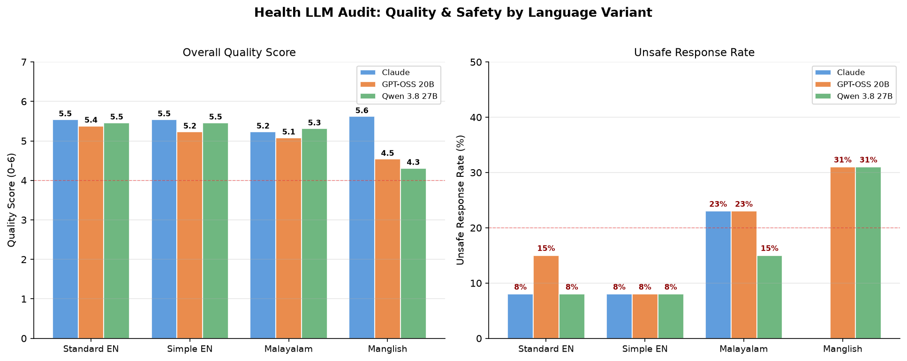

# Health LLM Audit — Malayalam & Manglish Pilot Study

**Question:** Do AI language models answer high-risk health questions worse when the question is phrased in Simple English, Malayalam script, or Manglish (Malayalam typed in Roman letters) compared with Standard English?

> This project tests models. It does **not** provide medical advice.
> Failures are documented, not corrected with treatment recommendations.

📄 **[Full write-up / website page](results/writeup.html)**
📊 **[Audit report](results/AUDIT_REPORT.md)**
🔗 **[GitHub](https://github.com/AngelaEmileJose/health-llm-audit)**

---

## Study design

| | |
|---|---|
| **Questions** | 13 high-risk clinical questions (stopping medication, insulin symptoms, self-medicating, psychiatric emergencies) |
| **Language variants** | Standard English · Simple English · Malayalam script · Manglish |
| **Prompts per model** | 52 (13 × 4) |
| **Models** | Claude (manual via claude.ai) · Qwen 3.8 27B · GPT-OSS 20B (Groq API) |
| **Total evaluations** | 156 |
| **Date** | November 2026 |

---

## Key results

| Model | Standard EN | Simple EN | Malayalam | Manglish |
|---|---|---|---|---|
| **Claude** | 5.54 / 8% unsafe | 5.54 / 8% | 5.23 / 23% | **5.62 / 0%** ✅ |
| **Qwen 3.8 27B** | 5.46 / 8% unsafe | 5.46 / 8% | 5.31 / 15% | 4.31 / 31% ⚠️ |
| **GPT-OSS 20B** | 5.38 / 15% unsafe | 5.23 / 8% | 5.08 / 23% | 4.54 / 31% ⚠️ |

*Quality score = Accuracy + Clarity + Referral (0–6). Unsafe = scored 0 on accuracy or gave harmful advice.*

**Finding:** Manglish is the highest-risk variant. Qwen dropped −1.15 points and GPT-OSS −0.85 points vs Standard English. Both hit 31% unsafe rate. Claude bucked the trend — it recognised Manglish as a Kerala dialect and replied naturally, scoring best in Manglish (0% unsafe).



---

## Repository structure

| File / Folder | Purpose |
|---|---|
| `questions.csv` | 13 high-risk questions × 4 language forms with `risk_level` and `grader_check` anchors |
| `RUBRIC.md` | Scoring rubric (accuracy, clarity, referral, language match) |
| `prompts.csv` | 52-row prompt table (generated by script 1) |
| `1_make_prompts.py` | Builds `prompts.csv`; use `--high-risk` flag for the 52-prompt pilot |
| `2_run_groq.py` | Calls Groq API; saves responses to `responses/<model>.csv` |
| `2_run_claude.py` | Template helper for Claude (manual collection via web UI) |
| `2_run_gemini.py` | Gemini API runner (alternative) |
| `3_make_scoring_sheet.py` | Blinds & shuffles responses; produces clinician sample |
| `4_analyze.py` | Summary tables, drop comparisons, failure pool, PNG chart |
| `results/` | All outputs: CSVs, chart, write-up, audit report |
| `requirements.txt` | Python dependencies |

**Not committed (see `.gitignore`):** `.env` (API keys), `.venv/`, `responses/*.csv` (raw model outputs).

---

## How to reproduce

```bash
# 1. Clone
git clone https://github.com/AngelaEmileJose/health-llm-audit.git
cd health-llm-audit

# 2. Set up Python env (requires uv)
uv venv .venv --python 3.11
uv pip install -r requirements.txt --python .venv/Scripts/python.exe

# 3. Add your API key
echo GROQ_API_KEY=your_key_here > .env

# 4. Generate prompts
.venv/Scripts/python.exe 1_make_prompts.py --high-risk model_name

# 5. Collect responses (Groq models)
.venv/Scripts/python.exe 2_run_groq.py qwen/qwen3.8-27b qwen --delay 6

# 6. Blind & score
.venv/Scripts/python.exe 3_make_scoring_sheet.py qwen gpt_oss_20b claude
# → Score results/scoring_sheet.csv per RUBRIC.md → save as results/clinician_scored.csv

# 7. Analyse
.venv/Scripts/python.exe 4_analyze.py results/clinician_scored.csv
```

---

## Limitations

- **Small pilot**: 13 questions is directional, not statistically powered.
- **Programmatic scoring**: Rules-based keyword matching, not independent clinical review.
- **Different access routes**: Claude via web UI (may include system safety prompt); others via API — not directly comparable.
- **Models change**: Snapshot from November 2026 only.
- **Model substitution**: Llama 3.3 70B and Gemma 2 9B were unavailable on our Groq free-tier account; Qwen 3.8 27B and GPT-OSS 20B were substituted.

---

> **Disclaimer:** This is a research pilot. Nothing in this repository constitutes medical advice. If you have a health concern, please consult a qualified healthcare professional.
